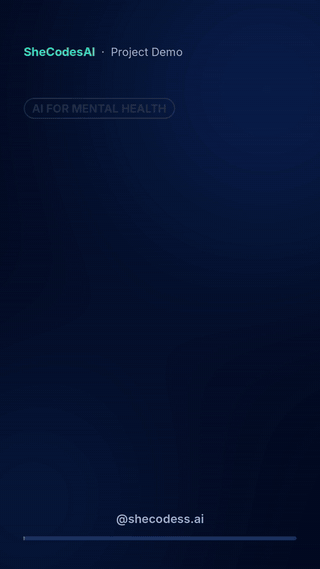
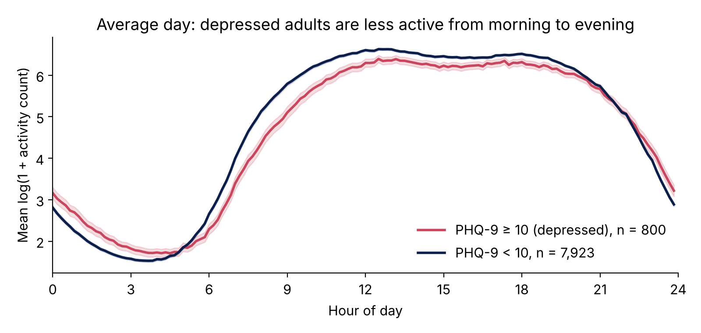
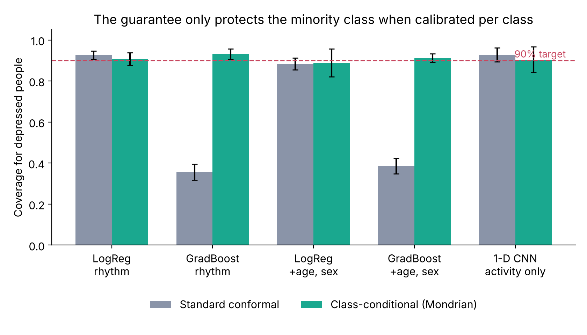
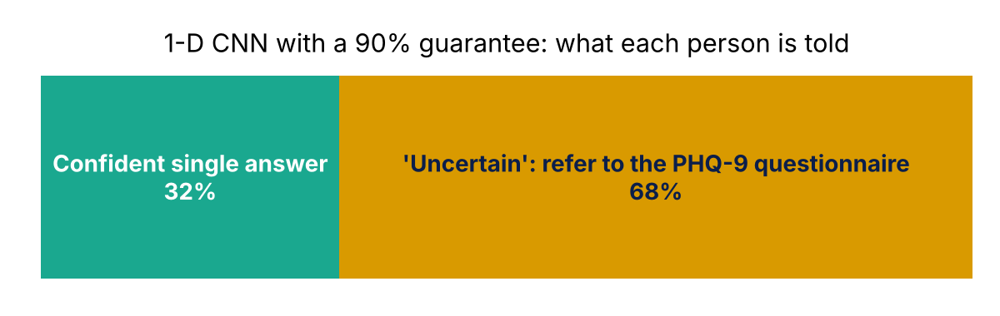
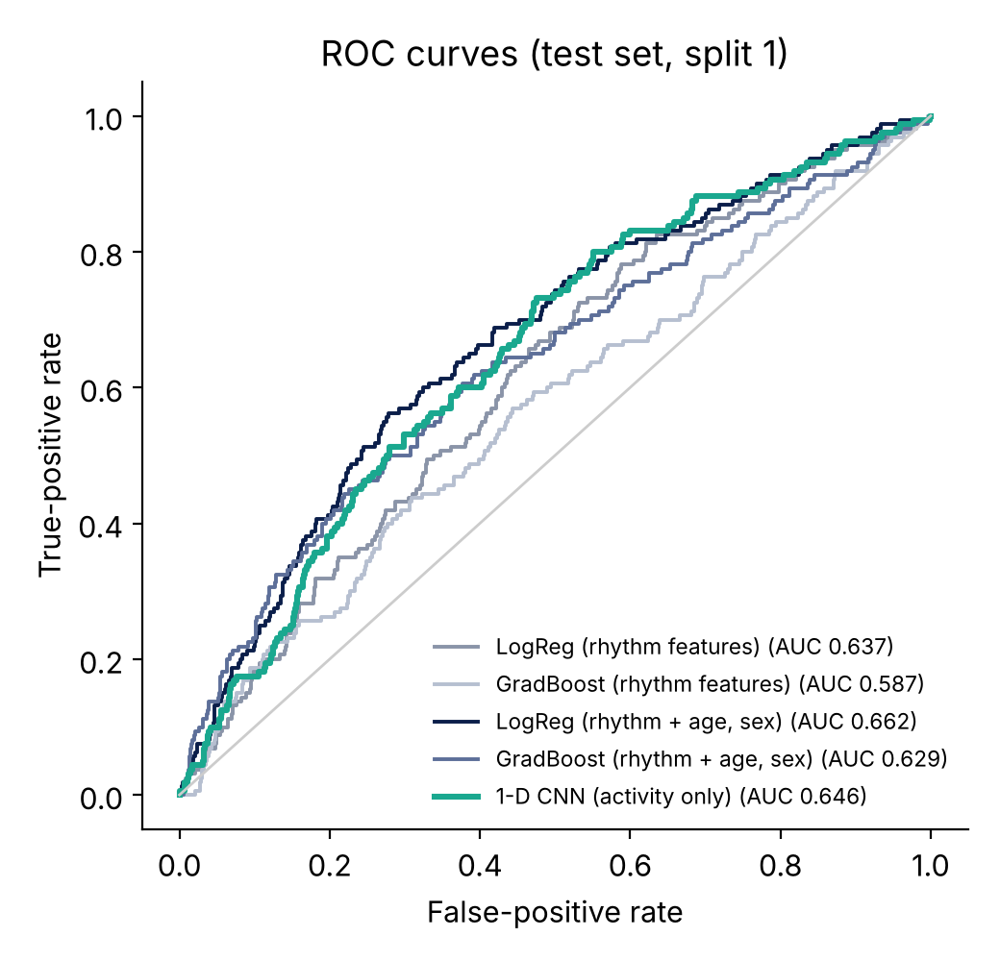
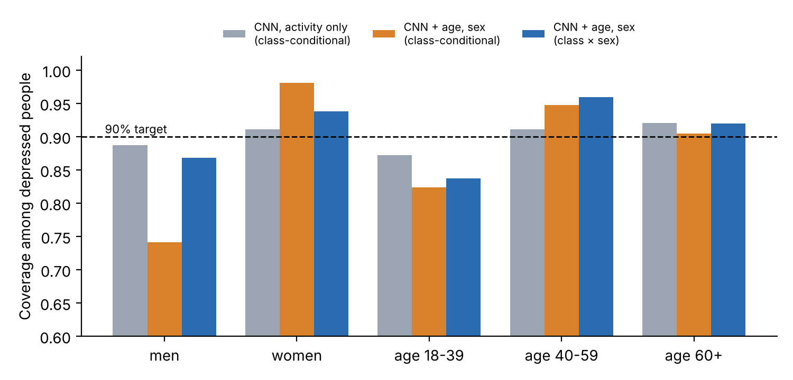

# WearCNN-Guard

<p align="center"><a href="https://github.com/AbbasiSarah/wearcnn-guard/blob/main/assets/demo.mp4"></a><br><sub>17-second demo. Click for the video with sound.</sub></p>

**Depression screening from one week of wrist activity, with a provable 90% guarantee.**

A 1-D convolutional neural network, written from scratch in NumPy, reads one week of minute-by-minute wrist activity from **8,723 US adults (NHANES 2011–2014)** and screens for depression (PHQ-9 ≥ 10). Instead of a single yes/no answer, it returns a **conformal prediction set** that contains the true answer at least 90% of the time. With class-conditional ("Mondrian") calibration, that guarantee also holds for depressed people specifically, not just on average.

> This is a research project, not a medical device. The PHQ-9 is itself a screening questionnaire, not a diagnosis.



## Key results (5 random person-level splits, mean ± SD)

| Model | AUC | AUPRC | Coverage (all) | Coverage (depressed), Mondrian | Coverage (depressed), standard | Confident single answer |
|---|---|---|---|---|---|---|
| LogReg (rhythm features) | 0.637 ± 0.024 | 0.155 | 0.903 | 0.907 | 0.926 | 29% |
| GradBoost (rhythm features) | 0.587 ± 0.019 | 0.127 | 0.902 | 0.931 | **0.356** | 21% |
| LogReg (rhythm + age, sex) | 0.662 ± 0.022 | 0.178 | 0.899 | 0.889 | 0.884 | 33% |
| GradBoost (rhythm + age, sex) | 0.629 ± 0.018 | 0.153 | 0.894 | 0.912 | **0.385** | 27% |
| **1-D CNN (activity only)** | **0.646 ± 0.024** | 0.160 | 0.900 | 0.904 | 0.927 | 32% |

Guarantee level 90% (α = 0.1). The base rate of PHQ-9 ≥ 10 is 9.2% (800 of 8,723), so an AUPRC of 0.092 would mean no skill.

**What this shows**

1. **The CNN learns from raw activity.** Using activity alone, the 1-D CNN (AUC 0.646) matches or beats models built on hand-crafted circadian-rhythm features (0.637 and 0.587). Adding age and sex helps more (0.662), so a future version should feed demographics into the CNN.
2. **The guarantee holds in practice.** Coverage stays close to 90% in every model and every split, as the theory says it must.
3. **Standard conformal prediction can fail the people who matter most.** With gradient boosting, the usual (marginal) calibration covered only **36–39% of depressed people**, while the overall coverage still looked fine at 90%. Calibrating each class separately fixes this.
4. **One week of activity is not enough for most people, and the method says so.** Only about a third of people get a single confident answer. The rest get "uncertain", which means "use the questionnaire". The guarantee makes it clear when a wearable screen can be trusted.





## Extra experiments (paper analyses)

`run_extra.py` uses the same 5 person-level splits. Each 95% CI is a bootstrap over test people (1,000 resamples), with the bounds averaged across splits.

| Model | AUC (mean ± SD) | 95% CI | Depressed coverage, standard | Depressed coverage, class-conditional |
|---|---|---|---|---|
| 1-D CNN (activity only) | 0.646 ± 0.024 | 0.600–0.689 | 0.927 | 0.904 |
| LogReg (rhythm + age, sex) | 0.662 ± 0.022 | 0.617–0.706 | 0.884 | 0.889 |
| **1-D CNN + age, sex** | **0.681 ± 0.020** | 0.636–0.726 | 0.839 | 0.897 |
| CNN + LogReg ensemble | 0.680 ± 0.022 | 0.635–0.725 | 0.859 | 0.893 |

1. **Age and sex improve the CNN.** They enter the CNN as two extra constant input channels, which raises its AUC from 0.646 to 0.681. That beats the best feature-based model (0.662), though the confidence intervals overlap.
2. **The guarantee holds at every level.** At 80%, 90% and 95%, overall coverage was 0.80, 0.90 and 0.95. Class-conditional calibration kept depressed-person coverage at the target each time (0.80, 0.90, 0.95), while standard calibration fell short for the CNN + age, sex model (0.71, 0.84, 0.92).
3. **New finding: adding demographics breaks fairness by sex.** With class-conditional calibration, the CNN + age, sex model covered only **74% of depressed men**, against 98% of depressed women. The activity-only CNN was balanced (89% vs 91%). Calibrating separately for each sex × class pair brings depressed men back to 87% and women to 94%, with only slightly fewer confident answers (31% vs 33%). There are about 56 depressed men per test split, so these subgroup numbers are noisy.
4. **A simple "unsure near 50%" rule** was tuned to abstain as often as conformal does. It covered 87% of depressed people, versus 90% for class-conditional conformal. It also comes with no guarantee, and its coverage cannot be set in advance.



## The method

**Data.** Minute-level wrist activity counts (NHANES 2011–2014), demographics (DEMO_G, DEMO_H) and the PHQ-9 questionnaire (DPQ_G, DPQ_H). A day counts if the device was worn for at least 10 hours; non-wear is any run of 60 or more zero minutes; each person needs at least 4 valid days. Activity is log-transformed and averaged into 144 ten-minute bins per day.

**Models.** Each person appears in exactly one of training (60%), calibration (20%) and test (20%), so no person is ever both trained and tested on.
- *1-D CNN* (NumPy, no framework): input = 2 channels × 144 bins (the person's average day and its day-to-day standard deviation); 3 convolution layers, global average pooling, dropout, a sigmoid output, class-balanced loss, and an ensemble of 3 seeds.
- *Baselines*: logistic regression and gradient boosting on 9 standard actigraphy features (M10, L5, relative amplitude, inter-daily stability, intra-daily variability, total activity, sedentary share, peak hour, day-to-day SD), with and without age and sex.

**Conformal prediction sets.** With score s(x, y) = 1 − p̂(y | x) and q̂ the ⌈(n + 1)(1 − α)⌉-th smallest calibration score, the set is C(x) = {y : s(x, y) ≤ q̂}.

*Theorem (split conformal; Vovk et al., 2005).* If calibration and test people are exchangeable, then P(Y ∈ C(X)) ≥ 1 − α.
*Proof sketch.* The test score is equally likely to take any rank among the n + 1 scores, so it is at most q̂ with probability ⌈(n + 1)(1 − α)⌉ / (n + 1) ≥ 1 − α. ∎

Computing q̂ separately within each true class (Mondrian conformal) gives P(Y ∈ C(X) | Y = y) ≥ 1 − α for **each** class y. That's what protects the depressed minority.

## Run it

```bash
pip install -r requirements.txt
python prep.py /path/to/nhanes_folder   # needs nhanes_1440_AC.csv.xz, DEMO_G/H.xpt, DPQ_G/H.xpt
python run_experiments.py               # about 6 minutes on a laptop CPU
python build_inputs.py && python run_extra.py && python make_fig_extra.py   # extra analyses, about 13 minutes
python make_figures.py
python -m pytest -q tests               # coverage simulation + CNN gradient check
```

The NHANES data are public (CDC National Health and Nutrition Examination Survey) and are not included in this repository.

## Project structure

```
prep.py                  minute data -> weekly profiles + PHQ-9 labels
run_experiments.py       5 person-level splits, all models, conformal evaluation
make_figures.py          figures in results/
src/wearcnn_guard/
  cnn.py                 NumPy layers (from my depression-bipolar_CNN project)
  model.py               multi-channel weekly CNN
  features.py            CNN inputs and circadian-rhythm features
  conformal.py           split and Mondrian conformal prediction
tests/test_conformal.py  checks the guarantee and the gradients
```

## Limitations

- PHQ-9 ≥ 10 is a screening threshold, not a clinical diagnosis.
- NHANES is cross-sectional and US-based; results may differ in Pakistan or other low-resource settings.
- The guarantee assumes new people resemble the calibration people (exchangeability). For a new population, the model must be recalibrated on local data.
- Coverage is guaranteed on average over calibration draws; any single split can fall slightly below 90%, as the table shows.

## Next step
Testing the pipeline on data from a consumer smartwatch (Mi Watch Lite via Mi Fitness / Health Connect) to measure how well the model and its guarantee transfer from research actigraphs to everyday devices.

## Related work by me

- [depression-bipolar_CNN](https://github.com/AbbasiSarah/depression-bipolar_CNN): detecting and forecasting depressive episodes with a NumPy 1-D CNN (Depresjon dataset).

## Author

**Sara Abbasi** · SheCodesAI · [abbasisarah.github.io](https://abbasisarah.github.io)

## References

- Vovk, V., Gammerman, A., & Shafer, G. (2005). *Algorithmic Learning in a Random World*. Springer.
- Angelopoulos, A. N., & Bates, S. (2023). Conformal prediction: A gentle introduction. *Foundations and Trends in Machine Learning*, 16(4), 494–591.
- Kroenke, K., Spitzer, R. L., & Williams, J. B. W. (2001). The PHQ-9: Validity of a brief depression severity measure. *Journal of General Internal Medicine*, 16(9), 606–613.
